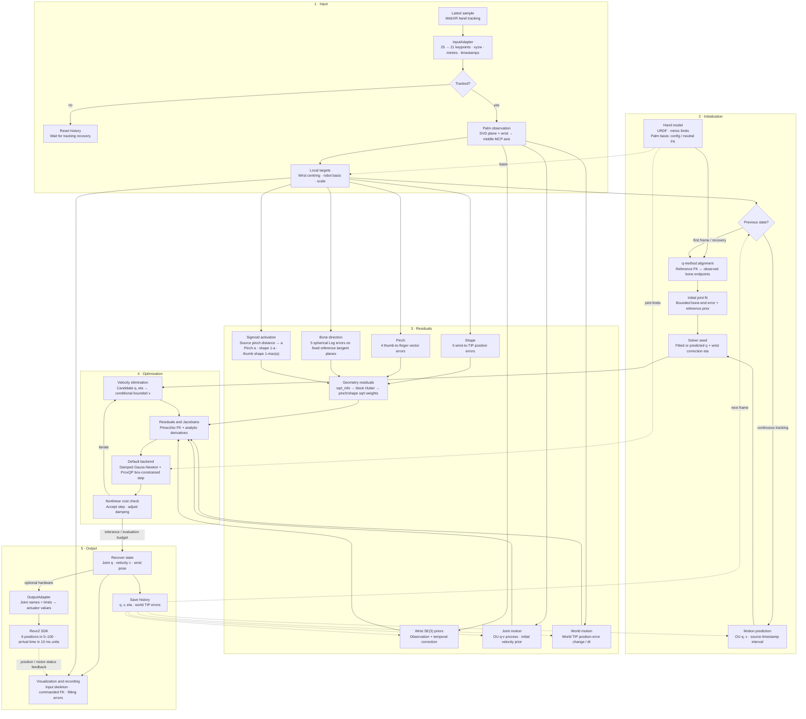
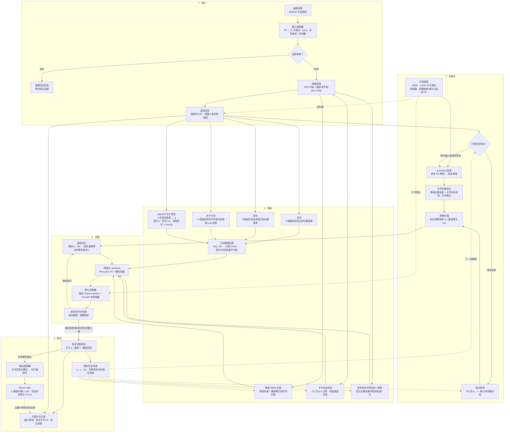

# agx-retargeting

[](CHANGELOG) [](LICENSE)

[English](#english) | [中文](#中文)

## English

Dexterous hand retargeting with adaptable input devices and robot hands. Input and output adapters share a common retargeting core, with joint optimization, motion priors, and visualization.

| Component | Included support |
| --- | --- |
| Input | Quest / WebXR |
| Hand models | Revo2, Wuji Hand; left and right |
| Hardware output | Revo2 through the arm controller SDK |
| Visualization | Robot hand, tracked skeleton, and fitting errors |

### Quickstart

Requires Python 3.10+. Run from the repository root:

```bash
python -m pip install -e '.[webxr,visualization]'
python -m agx_retargeting.inputs.webXR --init-certs
python -m agx_retargeting.inputs.webXR --hand left --viewer
```

On Quest, open `https://<computer-IP>:9443/`, accept the development certificate, and enter XR with hand tracking. On the computer, open `http://127.0.0.1:8080/`. Use `--hand left --viewer` to select left Revo2 and enable visualization.

```bash
python -m agx_retargeting.inputs.webXR --model wuji_hand --hand right
python -m agx_retargeting.inputs.webXR --hand both --viewer-hand right
python -m agx_retargeting.inputs.webXR --help
```

For USB, run `adb reverse tcp:9443 tcp:9443` and open `https://localhost:9443/` on Quest. To record, create the destination directory and pass `--output <path>.jsonl`.

### Revo2 example

Connect and enable Revo2 through its arm controller. On Linux, configure SocketCAN at 1 Mbit/s:

```bash
python -m pip install -e '.[revo2]'
sudo ip link set can0 type can bitrate 1000000
sudo ip link set can0 up
python -m agx_retargeting.inputs.webXR --hand left --revo2-left-can can0 --revo2-robot nero --revo2-firmware v120
```

This command selects Nero `v120` with a 40 ms arrival time. Select the controller with `--revo2-robot` and `--revo2-firmware`. Right-hand output uses `--hand right --revo2-right-can can0`; each hand requires its own CAN interface. The viewer displays commanded joints.

### Configuration

Runtime defaults are defined in [session.py](agx_retargeting/inputs/webXR/session.py). An optional `--session <path>` loads a session YAML; CLI arguments override YAML. Restart after editing.

Hand geometry, landmark correspondence, coordinate transforms, and motion settings are defined in [revo2_params.yaml](agx_retargeting/config/revo2_params.yaml) and [wuji_hand_params.yaml](agx_retargeting/config/wuji_hand_params.yaml). Residual and solver settings are in [optimizer_params.yaml](agx_retargeting/config/optimizer_params.yaml).

| Optimization field | Default | Meaning |
| --- | --- | --- |
| `initializer.position_sigma`, `smooth_weight`, `max_evaluations` | `0.05`, `2.5`, `10` | Bone-end position scale (m), initial joint-reference weight, initialization budget |
| `residual.pair_sigma`, `shape_sigma`, `bone_sigma` | `0.0075`, `0.02`, `0.6` | Pinch-vector scale (m), wrist-to-TIP scale (m), terminal direction scale (rad) |
| `residual.pinch.center_distance`, `slope` | `0.04`, `100` | Complementary pinch/shape activation centre (m) and slope (1/m) |
| `residual.motion_sigma`, `motion_weight` | `0.7`, `0.1` | World position-error change scale (m/s) and task weight |
| `residual.huber_delta` | `2` | Block Huber threshold after residual normalization |
| `solver.backend` | `proxqp` | Backend for initialization and online solves: `proxqp` or `dogbox` |
| `solver.max_evaluations` | `20` | Online function-evaluation budget |
| `solver.proxqp.initial_damping` | `1.0e-4` | Initial damping of the scaled Gauss–Newton model |
| `solver.proxqp.absolute_tolerance`, `max_iterations` | `1.0e-9`, `100` | Absolute QP tolerance ceiling and per-QP iteration budget |

Smaller residual scales increase task influence. Wrist observation/process scales and joint acceleration noise configure the motion priors. `motion.velocity_decay_s` in the hand YAML controls velocity-prior decay: Revo2 `0.02` s, Wuji Hand `0.03` s. `output.arrival_time` in the session controls hardware movement duration in seconds.

### Adapt inputs and outputs

Adapter contracts are defined in [adapter.py](agx_retargeting/adapter.py); shared data types are in [types.py](agx_retargeting/types.py). Import hand models and retargeting from [agx_retargeting.core](agx_retargeting/core/__init__.py), optimizers from [agx_retargeting.opt](agx_retargeting/opt/__init__.py), and bundled configuration paths from `agx_retargeting.config.CONFIG_DIR`. Use these skills with your coding agent:

| Skill | Provide |
| --- | --- |
| [agx-adapt-input](skills/agx-adapt-input/SKILL.md) | Device SDK, keypoint layout, coordinates, units, and timestamps |
| [agx-adapt-output](skills/agx-adapt-output/SKILL.md) | Hand URDF, meshes, SDK, and actuator calibration |

```text
Use skills/agx-adapt-input/SKILL.md to adapt <device SDK> to HandInput.
Use skills/agx-adapt-output/SKILL.md to integrate <hand URDF and output SDK>.
```

### Pipeline



## 中文

面向多种输入设备与灵巧手的手部重定向，输入和输出通过适配器连接统一的重定向核心。已支持 Quest/WebXR 输入、Revo2 与 Wuji Hand 左右手模型、Revo2 SDK 硬件输出，以及机器人与追踪骨架可视化。

### 快速开始

需要 Python 3.10 以上版本，在仓库根目录执行：

```bash
python -m pip install -e '.[webxr,visualization]'
python -m agx_retargeting.inputs.webXR --init-certs
python -m agx_retargeting.inputs.webXR --hand left --viewer
```

Quest 打开 `https://<电脑IP>:9443/`，接受开发证书并进入手部追踪 XR 会话；电脑打开 `http://127.0.0.1:8080/` 查看机器人与骨架。通过 `--hand left --viewer` 选择左手并开启显示。

```bash
python -m agx_retargeting.inputs.webXR --model wuji_hand --hand right
python -m agx_retargeting.inputs.webXR --hand both --viewer-hand right
python -m agx_retargeting.inputs.webXR --help
```

USB 连接需要执行 `adb reverse tcp:9443 tcp:9443`，随后在 Quest 打开 `https://localhost:9443/`。录制数据时，提前创建目标目录并传入 `--output <路径>.jsonl`。

### Revo2 示例

通过机械臂控制器连接并使能 Revo2，在 Linux 下配置 1 Mbit/s 的 SocketCAN：

```bash
python -m pip install -e '.[revo2]'
sudo ip link set can0 type can bitrate 1000000
sudo ip link set can0 up
python -m agx_retargeting.inputs.webXR --hand left --revo2-left-can can0 --revo2-robot nero --revo2-firmware v120
```

上述命令使用 Nero `v120`，到达时间为 40 ms。通过 `--revo2-robot` 和 `--revo2-firmware` 选择实际控制器配置。右手使用 `--hand right --revo2-right-can can0`，每只手需要独立的 CAN 接口。可视化页面显示命令关节。

### 配置参数

运行默认配置定义在 [session.py](agx_retargeting/inputs/webXR/session.py)，可选参数 `--session <路径>` 加载会话 YAML，命令行参数覆盖 YAML。修改配置后重新启动程序。

手部几何、关键点对应、坐标变换和运动参数位于 [revo2_params.yaml](agx_retargeting/config/revo2_params.yaml) 与 [wuji_hand_params.yaml](agx_retargeting/config/wuji_hand_params.yaml)，残差和求解器参数位于 [optimizer_params.yaml](agx_retargeting/config/optimizer_params.yaml)。

| 优化字段 | 默认值 | 含义 |
| --- | --- | --- |
| `initializer.position_sigma`、`smooth_weight`、`max_evaluations` | `0.05`、`2.5`、`10` | 骨端位置尺度（米）、初始关节参考权重、初始化评估次数 |
| `residual.pair_sigma`、`shape_sigma`、`bone_sigma` | `0.0075`、`0.02`、`0.6` | 捏合向量尺度（米）、腕部至 TIP 尺度（米）、末节方向尺度（弧度） |
| `residual.pinch.center_distance`、`slope` | `0.04`、`100` | 捏合与形状互补激活的中心距离（米）和斜率（1/米） |
| `residual.motion_sigma`、`motion_weight` | `0.7`、`0.1` | 世界坐标中位置误差变化的尺度（米/秒）及任务权重 |
| `residual.huber_delta` | `2` | 残差归一化后，作用于残差分组的 Huber 阈值 |
| `solver.backend` | `proxqp` | 初始化与在线求解的后端，可设为 `proxqp` 或 `dogbox` |
| `solver.max_evaluations` | `20` | 在线函数评估次数上限 |
| `solver.proxqp.initial_damping` | `1.0e-4` | 缩放后的 Gauss–Newton 模型的初始阻尼 |
| `solver.proxqp.absolute_tolerance`、`max_iterations` | `1.0e-9`、`100` | QP 绝对容差上限与每个 QP 的迭代次数上限 |

残差尺度越小，对应任务的影响越大。腕部观测尺度、过程尺度和关节加速度噪声控制运动先验。手模型的 `motion.velocity_decay_s` 控制速度先验衰减时间，Revo2 为 `0.02` 秒，Wuji Hand 为 `0.03` 秒；会话的 `output.arrival_time` 控制硬件到达时间，单位为秒。

### 适配输入与输出

适配器接口位于 [adapter.py](agx_retargeting/adapter.py)，共享数据类型位于 [types.py](agx_retargeting/types.py)。手部模型与重定向从 [agx_retargeting.core](agx_retargeting/core/__init__.py) 导入，求解器从 [agx_retargeting.opt](agx_retargeting/opt/__init__.py) 导入，内置配置目录通过 `agx_retargeting.config.CONFIG_DIR` 获取。向代码代理提供以下 skill 及设备资料：

| Skill | 所需资料 |
| --- | --- |
| [agx-adapt-input](skills/agx-adapt-input/SKILL.md) | 设备 SDK、关键点顺序、坐标约定、单位和时间戳 |
| [agx-adapt-output](skills/agx-adapt-output/SKILL.md) | 灵巧手 URDF、meshes、SDK 和执行器标定 |

```text
使用 skills/agx-adapt-input/SKILL.md，将 <设备 SDK> 适配为 HandInput。
使用 skills/agx-adapt-output/SKILL.md，接入 <灵巧手 URDF 与输出 SDK>。
```

### 算法流程


