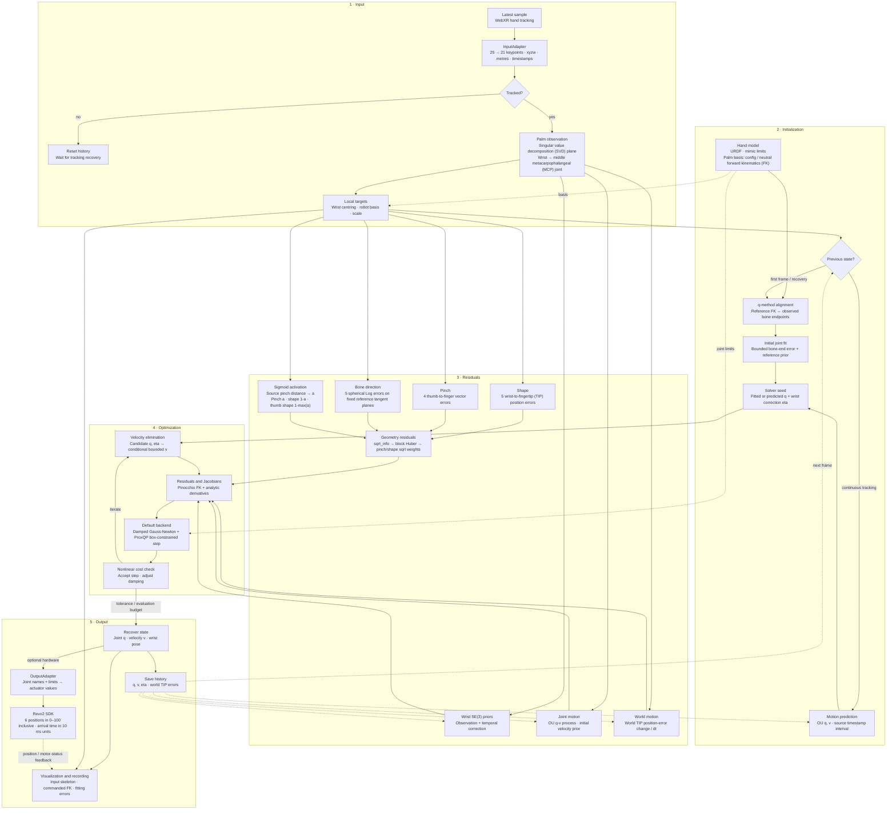
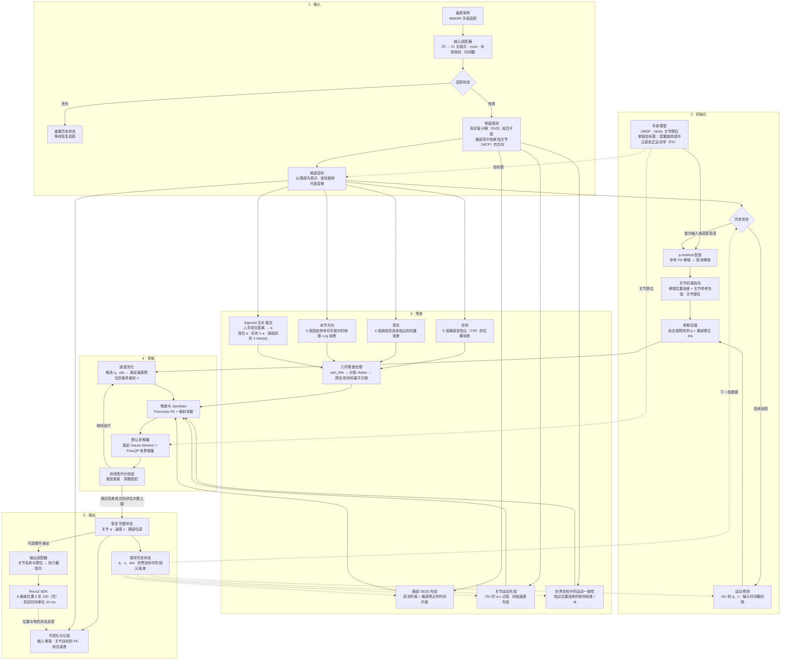

# agx-retargeting

[](CHANGELOG) [](LICENSE)

[English](#english) | [中文](#中文)

## English

Convert tracked human hands into robot joint targets. Input and output adapters connect devices to a shared retargeting core.

| Component | Included support |
| --- | --- |
| Input | Quest / WebXR |
| Hand models | Revo2, Wuji Hand; left and right |
| Hardware output | Revo2 through the arm controller software development kit (SDK) |
| Visualization | Robot hand, tracked skeleton, and fitting errors |

### Quickstart

Requires Python 3.10 or later. Run commands from the repository root.

1. Install the dependencies.

   ```bash
   python -m pip install -e '.[webxr,visualization]'
   ```

2. Generate the development certificate.

   ```bash
   python -m agx_retargeting.inputs.webXR --init-certs
   ```

3. Start left Revo2 retargeting with visualization.

   ```bash
   python -m agx_retargeting.inputs.webXR --hand left --viewer
   ```

Connect the browsers:

1. Open `https://<computer-IP>:9443/` in the Quest browser.
2. Accept the development certificate.
3. Enter an extended reality (XR) session with hand tracking.
4. Open `http://127.0.0.1:8080/` on the computer.

| Session | Command |
| --- | --- |
| Right Wuji Hand | `python -m agx_retargeting.inputs.webXR --model wuji_hand --hand right` |
| Both hands, right-hand visualization | `python -m agx_retargeting.inputs.webXR --hand both --viewer --viewer-hand right` |
| All options | `python -m agx_retargeting.inputs.webXR --help` |

USB forwarding uses `adb reverse tcp:9443 tcp:9443`. The Quest address is `https://localhost:9443/`.

The recording directory must exist. `--output <path>.jsonl` records per-frame results.

### Revo2 example

The Revo2 must be connected to its arm controller and enabled. This example uses Linux SocketCAN at 1 Mbit/s.

1. Install the Revo2 SDK dependency.

   ```bash
   python -m pip install -e '.[revo2]'
   ```

2. Set the Controller Area Network (CAN) bitrate.

   ```bash
   sudo ip link set can0 type can bitrate 1000000
   ```

3. Enable the CAN interface.

   ```bash
   sudo ip link set can0 up
   ```

4. Start hardware output.

   ```bash
   python -m agx_retargeting.inputs.webXR --hand left --revo2-left-can can0 --revo2-robot nero --revo2-firmware v120
   ```

The command selects Nero `v120`. The default arrival time is 40 ms. `--revo2-robot` and `--revo2-firmware` select the controller profile.

Right-hand output uses `--hand right --revo2-right-can can0`. Each hand requires a separate CAN interface. Visualization displays joint targets.

### Configuration

Runtime defaults come from [session.py](agx_retargeting/inputs/webXR/session.py). `--session <path>` loads a session YAML. Command-line arguments override session values. Configuration changes take effect after a restart.

Hand geometry, keypoint mapping, coordinates, and motion settings use [revo2_params.yaml](agx_retargeting/config/revo2_params.yaml) or [wuji_hand_params.yaml](agx_retargeting/config/wuji_hand_params.yaml). Residual and solver settings use [optimizer_params.yaml](agx_retargeting/config/optimizer_params.yaml).

| Optimization field | Default | Meaning |
| --- | --- | --- |
| `initializer.position_sigma`, `smooth_weight`, `max_evaluations` | `0.05`, `2.5`, `10` | Bone-end position standard deviation (m), joint-reference weight, initialization evaluation limit |
| `residual.pair_sigma`, `shape_sigma`, `bone_sigma` | `0.0075`, `0.02`, `0.6` | Standard deviations: pinch vectors (m), wrist-to-fingertip positions (m), terminal directions (rad) |
| `residual.pinch.center_distance`, `slope` | `0.04`, `100` | Complementary pinch/shape activation centre (m) and slope (1/m) |
| `residual.motion_sigma`, `motion_weight` | `0.7`, `0.1` | Standard deviation of world position-error change (m/s) and task weight |
| `residual.huber_delta` | `2` | Block Huber threshold after residual normalization |
| `solver.backend` | `proxqp` | Backend for initialization and online solves: `proxqp` or `dogbox` |
| `solver.max_evaluations` | `20` | Online function-evaluation budget |
| `solver.proxqp.initial_damping` | `1.0e-4` | Initial damping of the scaled Gauss–Newton model |
| `solver.proxqp.absolute_tolerance`, `max_iterations` | `1.0e-9`, `100` | Quadratic program (QP): absolute tolerance ceiling and iteration limit |

Smaller residual standard deviations increase error penalties. `residual.wrist_sigma` and `residual.wrist_process_sigma` control wrist priors. `residual.acceleration_sigma` controls the joint motion prior.

`motion.velocity_decay_s` controls the Ornstein–Uhlenbeck (OU) velocity-prior decay time. The hand YAML defaults are `0.02` s for Revo2 and `0.03` s for Wuji Hand.

The session field `output.arrival_time` sets the hardware arrival time in seconds.

### Adapt inputs and outputs

Adapter interfaces use [adapter.py](agx_retargeting/adapter.py). Shared data types use [types.py](agx_retargeting/types.py).

| Import | Content |
| --- | --- |
| [agx_retargeting.core](agx_retargeting/core/__init__.py) | Hand models and retargeting |
| [agx_retargeting.opt](agx_retargeting/opt/__init__.py) | Optimizers |
| `agx_retargeting.config.CONFIG_DIR` | Bundled configuration directory |

| Skill | Provide |
| --- | --- |
| [agx-adapt-input](skills/agx-adapt-input/SKILL.md) | Device SDK, keypoint layout, coordinates, units, and timestamps |
| [agx-adapt-output](skills/agx-adapt-output/SKILL.md) | Unified Robot Description Format (URDF) file, meshes, SDK, and actuator calibration |

```text
Use skills/agx-adapt-input/SKILL.md to adapt <device SDK> to HandInput.
Use skills/agx-adapt-output/SKILL.md to integrate <hand URDF and output SDK>.
```

### Pipeline



### References

| Method | Paper | Official resources |
| --- | --- | --- |
| AKO | [Analyzing Key Objectives in Human-to-Robot Retargeting for Dexterous Manipulation](https://arxiv.org/abs/2506.09384) | [Project](https://mingrui-yu.github.io/retargeting/) · [Code](https://github.com/Mingrui-Yu/retargeting) |
| GeoRT | [Geometric Retargeting: A Principled, Ultrafast Neural Hand Retargeting Algorithm](https://arxiv.org/abs/2503.07541) | [Project](https://zhaohengyin.github.io/geort/) · [Code](https://github.com/facebookresearch/GeoRT) |
| TopoRetarget | [TopoRetarget: Interaction-Preserving Retargeting for Dexterous Manipulation](https://arxiv.org/abs/2606.16272) | [Project](https://toporetarget2026.github.io/TopoRetarget/) |

## 中文

将人手追踪数据转换为机器人关节目标。输入和输出适配器连接统一的重定向核心。

| 组件 | 已支持 |
| --- | --- |
| 输入 | Quest / WebXR |
| 手部模型 | Revo2、Wuji Hand，均支持左手和右手 |
| 硬件输出 | Revo2，通过机械臂控制器的软件开发工具包（SDK）连接 |
| 可视化 | 机器人手部、追踪骨架和拟合误差 |

### 快速开始

Python 版本必须不低于 3.10。命令的执行目录为仓库根目录。

1. 安装依赖。

   ```bash
   python -m pip install -e '.[webxr,visualization]'
   ```

2. 生成开发证书。

   ```bash
   python -m agx_retargeting.inputs.webXR --init-certs
   ```

3. 启动左手 Revo2 重定向和可视化。

   ```bash
   python -m agx_retargeting.inputs.webXR --hand left --viewer
   ```

连接浏览器：

1. 在 Quest 浏览器打开 `https://<电脑IP>:9443/`。
2. 接受开发证书。
3. 进入支持手部追踪的扩展现实（XR）会话。
4. 在电脑浏览器打开 `http://127.0.0.1:8080/`。

| 会话 | 命令 |
| --- | --- |
| Wuji Hand 右手 | `python -m agx_retargeting.inputs.webXR --model wuji_hand --hand right` |
| 双手输入，显示右手 | `python -m agx_retargeting.inputs.webXR --hand both --viewer --viewer-hand right` |
| 全部选项 | `python -m agx_retargeting.inputs.webXR --help` |

USB 转发命令为 `adb reverse tcp:9443 tcp:9443`。Quest 访问地址为 `https://localhost:9443/`。

录制目录必须已经存在。`--output <路径>.jsonl` 保存逐帧结果。

### Revo2 示例

Revo2 必须已经连接机械臂控制器并启用。本示例使用 Linux SocketCAN，通信速率为 1 Mbit/s。

1. 安装 Revo2 SDK 依赖。

   ```bash
   python -m pip install -e '.[revo2]'
   ```

2. 设置控制器局域网（CAN）的通信速率。

   ```bash
   sudo ip link set can0 type can bitrate 1000000
   ```

3. 启用 CAN 接口。

   ```bash
   sudo ip link set can0 up
   ```

4. 启动硬件输出。

   ```bash
   python -m agx_retargeting.inputs.webXR --hand left --revo2-left-can can0 --revo2-robot nero --revo2-firmware v120
   ```

命令选择 Nero `v120`，默认到达时间为 40 ms。`--revo2-robot` 和 `--revo2-firmware` 指定控制器配置。

右手输出使用 `--hand right --revo2-right-can can0`。每只手需要独立的 CAN 接口。可视化页面显示关节目标。

### 配置参数

运行默认配置定义在 [session.py](agx_retargeting/inputs/webXR/session.py)。`--session <路径>` 加载会话 YAML。命令行参数覆盖会话配置。配置修改在程序重启后生效。

手部几何、关键点映射、坐标变换和运动参数位于 [revo2_params.yaml](agx_retargeting/config/revo2_params.yaml) 或 [wuji_hand_params.yaml](agx_retargeting/config/wuji_hand_params.yaml)。残差和求解器参数位于 [optimizer_params.yaml](agx_retargeting/config/optimizer_params.yaml)。

| 优化字段 | 默认值 | 含义 |
| --- | --- | --- |
| `initializer.position_sigma`、`smooth_weight`、`max_evaluations` | `0.05`、`2.5`、`10` | 骨端位置标准差（m）、关节参考权重、初始化评估次数上限 |
| `residual.pair_sigma`、`shape_sigma`、`bone_sigma` | `0.0075`、`0.02`、`0.6` | 标准差：捏合向量（m）、腕部至指尖位置（m）、末节方向（rad） |
| `residual.pinch.center_distance`、`slope` | `0.04`、`100` | 捏合与形状互补激活的中心距离（米）和斜率（1/米） |
| `residual.motion_sigma`、`motion_weight` | `0.7`、`0.1` | 世界坐标中位置误差变化的标准差（m/s）和任务权重 |
| `residual.huber_delta` | `2` | 残差归一化后，作用于残差分组的 Huber 阈值 |
| `solver.backend` | `proxqp` | 初始化与在线求解的后端，可设为 `proxqp` 或 `dogbox` |
| `solver.max_evaluations` | `20` | 在线函数评估次数上限 |
| `solver.proxqp.initial_damping` | `1.0e-4` | 缩放后的 Gauss–Newton 模型的初始阻尼 |
| `solver.proxqp.absolute_tolerance`、`max_iterations` | `1.0e-9`、`100` | 二次规划（QP）的绝对容差上限和迭代次数上限 |

残差标准差越小，对应误差的惩罚越大。`residual.wrist_sigma` 和 `residual.wrist_process_sigma` 控制腕部先验。`residual.acceleration_sigma` 控制关节运动先验。

`motion.velocity_decay_s` 控制 Ornstein–Uhlenbeck（OU）速度先验的衰减时间。手部 YAML 的默认值为 Revo2 `0.02` s、Wuji Hand `0.03` s。

会话字段 `output.arrival_time` 设置硬件到达时间，单位为 s。

### 适配输入与输出

适配器接口位于 [adapter.py](agx_retargeting/adapter.py)。共享数据类型位于 [types.py](agx_retargeting/types.py)。

| 导入路径 | 内容 |
| --- | --- |
| [agx_retargeting.core](agx_retargeting/core/__init__.py) | 手部模型和重定向 |
| [agx_retargeting.opt](agx_retargeting/opt/__init__.py) | 求解器 |
| `agx_retargeting.config.CONFIG_DIR` | 内置配置目录 |

| Skill | 所需资料 |
| --- | --- |
| [agx-adapt-input](skills/agx-adapt-input/SKILL.md) | 设备 SDK、关键点顺序、坐标约定、单位和时间戳 |
| [agx-adapt-output](skills/agx-adapt-output/SKILL.md) | 统一机器人描述格式（URDF）文件、网格文件、SDK 和执行器标定 |

```text
使用 skills/agx-adapt-input/SKILL.md，将 <设备 SDK> 适配为 HandInput。
使用 skills/agx-adapt-output/SKILL.md，接入 <灵巧手 URDF 与输出 SDK>。
```

### 算法流程



### 参考资料

| 方法 | 论文 | 官方资料 |
| --- | --- | --- |
| AKO | [Analyzing Key Objectives in Human-to-Robot Retargeting for Dexterous Manipulation](https://arxiv.org/abs/2506.09384) | [项目页面](https://mingrui-yu.github.io/retargeting/) · [源代码](https://github.com/Mingrui-Yu/retargeting) |
| GeoRT | [Geometric Retargeting: A Principled, Ultrafast Neural Hand Retargeting Algorithm](https://arxiv.org/abs/2503.07541) | [项目页面](https://zhaohengyin.github.io/geort/) · [源代码](https://github.com/facebookresearch/GeoRT) |
| TopoRetarget | [TopoRetarget: Interaction-Preserving Retargeting for Dexterous Manipulation](https://arxiv.org/abs/2606.16272) | [项目页面](https://toporetarget2026.github.io/TopoRetarget/) |
